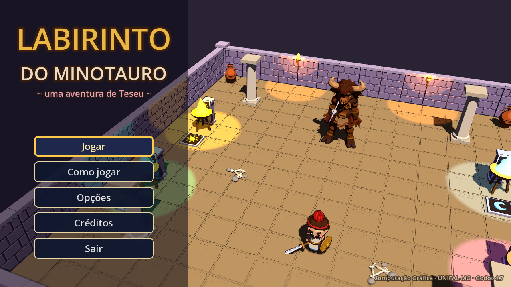
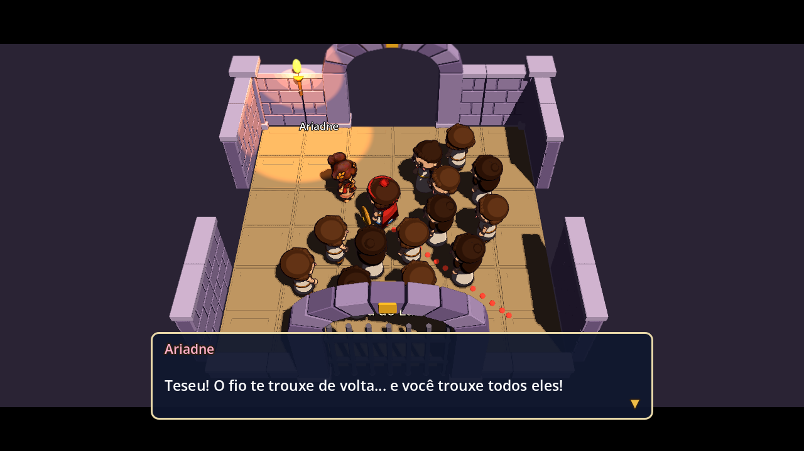
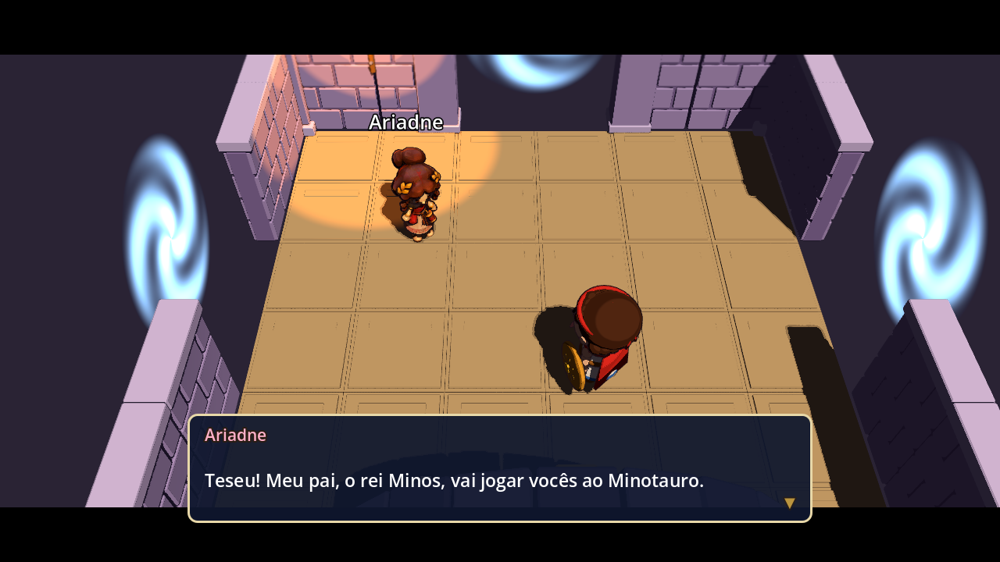
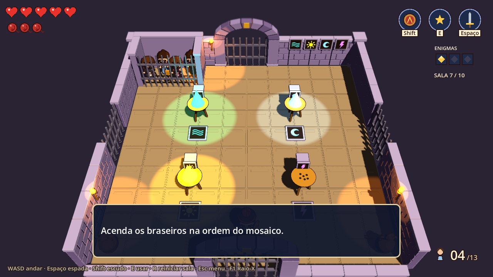
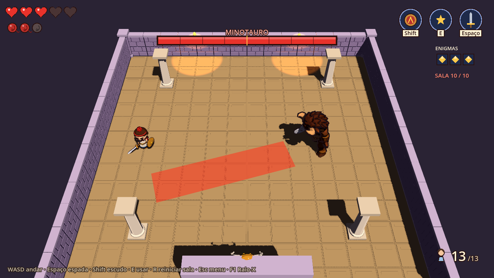
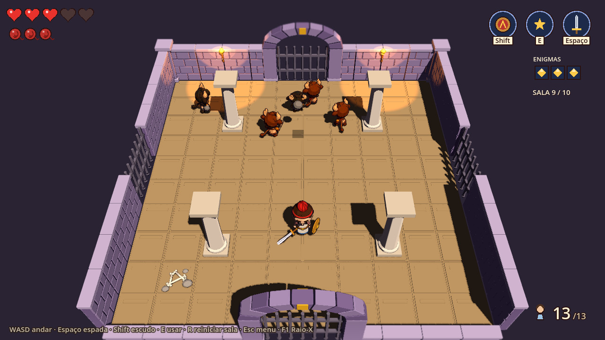
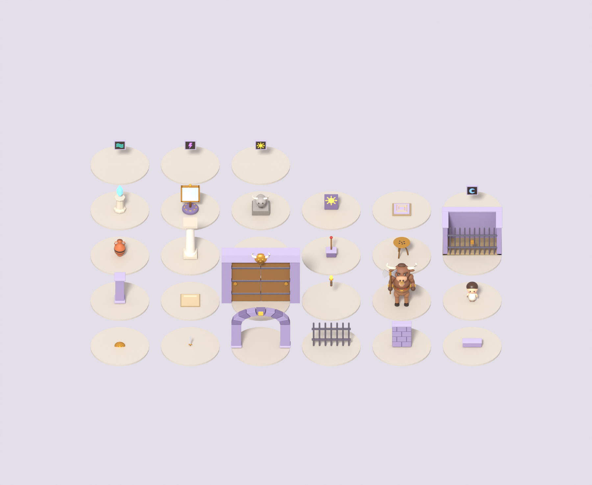
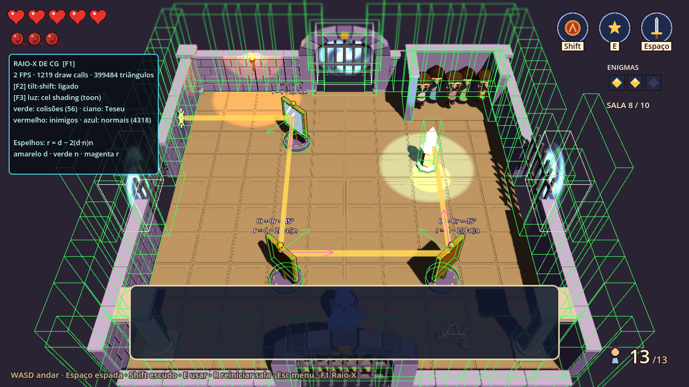
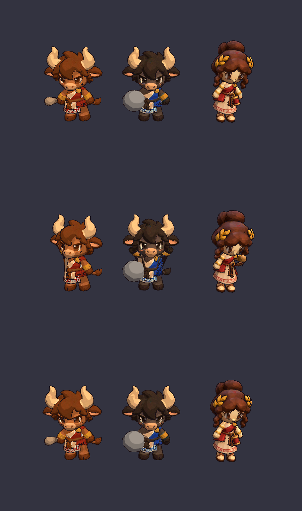

# Labirinto do Minotauro

Jogo 3D de ação e enigmas feito para a disciplina de **Computação Gráfica**
(Ciência da Computação, UNIFAL-MG), com **Blender** e **Godot 4.7**.
Visual de maquete de brinquedo, inspirado em *The Legend of Zelda: Link's Awakening* (remake).



## A história

Atenas deve pagar um tributo a Creta: 14 jovens são jogados no labirinto
construído por Dédalo, onde vive o Minotauro. **Teseu** se oferece como um
deles para acabar com isso. Na entrada, **Ariadne** lhe entrega um novelo de lã,
que é a chance de voltar se cair no labirinto.

Teseu atravessa portais para salas desconhecidas, liberta os 13 companheiros
presos resolvendo 3 enigmas e enfrenta o Minotauro.

## Como rodar

1. Instale o **Godot 4.7** (versão padrão).
2. Clone o repositório e, no Godot, clique em **Importar** e escolha o `project.godot`.
3. Espere a importação dos modelos e sons e aperte **F5** (abre a tela de título).

O projeto usa o renderizador **Compatibilidade** (OpenGL 3), que roda em máquinas
modestas e GPUs integradas. Em **Opções** dá para trocar a qualidade gráfica; em GPU
integrada (ex.: Radeon 610M, Intel UHD) o jogo já começa na qualidade **baixa**.

## Controles

| Tecla | Ação |
|---|---|
| WASD / setas | andar |
| Espaço / J | espada |
| Shift / L (segurar) | escudo: bloqueia golpes e pedras que vêm da frente |
| E / K | usar (alavanca, braseiro, espelho) |
| andar contra a estátua | empurrar |
| R | reiniciar a sala atual |
| Esc / P | menu de pausa |
| **F1** | **Raio-X de CG** (colisões, normais, vetores da reflexão, draw calls) |
| F2 | liga/desliga o tilt-shift |
| F3 | troca cel shading (toon) ↔ iluminação PBR padrão, para comparar |

---

## O que já temos

### Telas e história
- **Tela de título** com a arena em miniatura ao fundo: Jogar, Como jogar, Opções
  (qualidade gráfica, volume de música e efeitos), Créditos e Sair.
- **Cena de abertura:** Ariadne conversa com Teseu e o novelo voa até a cabeça dele
  (faixas de cinema, falas com nome; Espaço avança, Esc pula).
- **Game over** próprio quando o novelo acaba (tentar de novo ou menu inicial).
- **Final:** o fio de Ariadne leva o Teseu de volta à entrada, deixando um rastro
  vermelho no chão; os 13 atenienses saem do portal, a Ariadne vem recebê-lo e os
  **créditos** sobem na tela. Depois, a vitória com o resumo da partida.





### Estrutura do jogo
- **Salas ligadas por portais:** não há corredores. Toda sala tem a entrada embaixo
  e 3 portais (esquerda, cima, direita). Ao vencer a sala, cada portal ganha um
  destino **sorteado e escondido**.
- **A partida tem 10 salas:** a 10ª é sempre a arena do Minotauro. O sorteio força
  enigmas quando faltam poucas salas, então os 3 enigmas sempre ficam prontos até
  a 9ª. O HUD mostra "SALA n / 10".
- **3 salas de enigma + 3 salas de combate.** As de combate podem se repetir,
  com +1 inimigo a cada visita, e curam o Teseu quando vencidas.
- Ao entrar numa sala, as portas fecham com grade até os minitaurinhos serem derrotados.
- Depois da 9ª sala, todos os portais levam ao Minotauro.

### Enigmas
| Sala | Enigma |
|---|---|
| Sala das Estátuas | empurrar estátuas de touro até placas de pressão (com alavanca para reiniciar) |
| Sala dos Braseiros | acender braseiros na ordem do mosaico, cada símbolo com sua cor; errar chama reforço |
| Sala dos Espelhos | girar espelhos para levar um feixe de luz até um cristal |

**Os enigmas mudam a cada partida:** a ordem do mosaico e a posição dos símbolos nos
braseiros são sorteadas, os espelhos começam em ângulos sorteados e a Sala das Estátuas
pode aparecer espelhada (esquerda/direita).



### Chefe: o Minotauro
Corpo de cavalo, tronco e cabeça de touro, machado duplo. Padrões com aviso visual:
- **Golpe de machado:** ele ergue o machado e bate no chão, soltando uma onda de choque.
- **Investida:** uma faixa vermelha no chão avisa antes. Se ela **acertar**, o Teseu é jogado para o
  lado e o Minotauro freia. Se ele **errar** e bater numa parede ou coluna, fica **atordoado** e leva dano em dobro.
- Se o Teseu morrer na arena, o Minotauro recupera só **25% da vida** (não a vida toda).
- **Fase 2:** com metade da vida, fica mais rápido e chama 2 minitaurinhos.
- Barra de vida, tremor de câmera e tela de vitória.



### Combate
- **Escudo hoplon funcional:** segurando Shift, Teseu anda devagar e bloqueia o que vem
  da frente (minitaurinho e pedra: sem dano; Minotauro: metade). Pelas costas não protege.
- **Dois tipos de inimigo:** minitaurinho de corpo a corpo (3 golpes) e o **arremessador**
  (2 golpes), que foge de perto, ergue a pedra (aviso) e arremessa. A pedra tira 1 coração;
  o escudo bloqueia tudo e a espada quebra a pedra no ar.
- **Partículas:** faíscas na espada e no escudo, poeira dos cascos e da investida do
  Minotauro, fumaça quando um minitaurinho some, estilhaços de pedra.



### Som
- Efeitos para espada, acerto, dano, passos, escudo, portal, grade, braseiro, erro,
  enigma resolvido, rugido, cascos e golpes do Minotauro, menus e diálogos.
- **Músicas por tipo de sala:** título, exploração, enigma, combate e chefe (loops,
  com fade cruzado), mais os temas de vitória e game over.
- Tudo **sintetizado por código** (`ferramentas/audio/gerar_sons.py`): osciladores,
  ruído filtrado, envelopes e corda dedilhada Karplus-Strong para a lira grega.

### Sistemas
- **Novelo de Ariadne:** 3 voltas (respawns). Ele fica na cabeça do Teseu e encolhe a cada morte.
- **HUD estilo Link's Awakening:** corações com meio coração, novelos, botões
  de item, enigmas, contador de atenienses e caixa de diálogo com texto digitado.
- Reiniciar a sala (R), menu de pausa e reiniciar o jogo.
- Colisão robusta: empurrão por física, paredes grossas, chão infinito e resgate se cair do mapa.
- **Câmera de diorama:** travada no centro de cada sala e com zoom maior na arena.
- **Desempenho:** tilt-shift otimizado (9 amostras em vez de 25, e nenhuma na faixa nítida)
  e mais leve na arena; qualidade **baixa** desliga a luz dinâmica das tochas, o
  tilt-shift e o MSAA, simplifica a sombra e renderiza em 85% da resolução.

### Arte (Blender, gerada por script Python)
Kit modular do cenário (piso, paredes, pilares, arco, grades, tochas, portão),
props (colunas gregas, ânforas, ossos), objetos dos enigmas, **espada xiphos**,
**escudo hoplon** e o **Minotauro articulado**. Personagens no estilo das folhas
de modelo do grupo: **Teseu** (cabelo cacheado, faixa vermelha, túnica e capa),
**minitaurinho** (com clava) e **arremessador**, **Ariadne** (vestido lilás,
diadema e o novelo na mão) e os atenienses presos (**rapazes e moças**).
Todos têm pivôs (cabeça, braços, pernas, cauda) e são animados por código:
andam, erguem o escudo, golpeiam com a clava e pedem ajuda nas celas.



Modo Raio-X (F1) na sala dos espelhos: vetor incidente (amarelo), normal (verde),
refletido (magenta) e o ângulo em cada espelho:



### Personagens modelados pelo grupo (Minotauro, minitaurinho e Ariadne)
Os modelos enviados pelo grupo (≈1 milhão de vértices, texturas 4K) passam por
`ferramentas/blender/personagens_grupo.py`:
1. **Otimização:** decimação para ~9 mil triângulos e textura de 1024 px (só a cor).
2. **Rig:** esqueleto com Quadril, Tronco, Cabeca, BracoE/D, PernaE/D e Cauda.
   Pesos do minitaurinho por proximidade aos ossos (com regiões: cabeça, braços,
   pernas, cauda); os da Ariadne pelos pesos automáticos do Blender, corrigidos
   para o cabelo e a capa não seguirem os braços.
3. **Animações** (viram o AnimationPlayer no Godot):
   minitaurinho: `parado`, `andar`, `atacar` (clava), `erguer` e `arremessar` (pedra), `dano`;
   Ariadne: `parado`, `andar`, `arremessar` (joga o novelo para o Teseu);
   Minotauro (esqueleto completo: coxa/canela/pé, braço/antebraço/mão, machado de
   duas lâminas na mão direita): `parado`, `andar`, `correr` (investida, chifres
   para a frente), `rugir`, `mirar` (cava o chão), `erguer` e `golpe` (machado),
   `atordoado`, `frear` e `morrer`. Cada estado da IA toca a sua animação.
4. **Arremessador:** o mesmo modelo, com a textura recolorida em HSV
   (pelo escuro, roupa azul) — `minitaurinho_grupo_arremessador.glb`.

```bash
python3 ferramentas/blender/personagens_grupo.py otimizar <original.blend> minitaurinho_grupo
python3 ferramentas/blender/personagens_grupo.py montar minitaurinho_grupo
```

No jogo, `scripts/visual/anim_modelo.gd` troca entre `parado` e `andar` pela
velocidade e toca as ações (golpe, dano, arremesso).



### Técnicas de Computação Gráfica
| Técnica | Onde |
|---|---|
| **Cel shading** próprio: `N·L` quantizado em faixas, especular Blinn-Phong de corte seco e rim light `1 − N·V` | `scripts/visual/toon.gdshader` |
| **Contorno** por casca invertida (vértice inflado na normal + `cull_front`) | `scripts/visual/toon_contorno.gdshader` |
| Troca de materiais em tempo de execução (PBR → toon) | `scripts/visual/toon.gd` |
| Decimação de malha, rig, pintura de pesos e animação por esqueleto (skinning) | `ferramentas/blender/personagens_grupo.py` |
| Recoloração de textura em HSV (variação do arremessador) | `personagens_grupo.py` → `recolorir_arremessador` |
| **Modo Raio-X** (F1): linhas com `ImmediateMesh`, formas de colisão, normais dos vértices, vetores `d`, `n`, `r` | `scripts/visual/raio_x.gd` |
| Raycast + reflexão especular `r = d − 2(d·n)n` | `scripts/puzzles/espelhos/fonte_luz.gd` |
| Shader de portal (espiral em coordenadas polares) | `scripts/visual/portal.gdshader` |
| Pós-processamento tilt-shift (efeito miniatura) | `scripts/visual/tilt_shift.gdshader` |
| Sistemas de partículas (CPUParticles3D, billboards) | `scripts/visual/efeitos.gd` |
| Síntese sonora (Karplus-Strong, filtros IIR, convolução para reverb) | `ferramentas/audio/gerar_sons.py` |
| Animação procedural por pivôs (sem esqueleto) | `scripts/inimigos/minotauro.gd`, `scripts/visual/anim_boneco.gd` |
| Coração por curva paramétrica no HUD | `scripts/ui/hud_desenho.gd` |
| Malha gerada em código (rastro da espada) | `scripts/jogador/teseu_prototipo.gd` |
| MultiMesh para o piso (1 draw call por sala) | `ferramentas/godot/gerar_cenas.gd` |
| Modelagem procedural (bmesh / sólidos de revolução) | `ferramentas/blender/modelos.py` |

### Ferramentas
- `ferramentas/blender/modelos.py`: gera todos os modelos (`.glb` + `.blend`).
- `ferramentas/audio/gerar_sons.py`: gera todos os efeitos (`.wav`) e músicas (`.ogg`).
- `ferramentas/godot/gerar_cenas.gd`: monta todas as cenas a partir dos modelos.
- `ferramentas/godot/teste_automatico.gd`: joga o jogo sozinho e confere **mais de 110
  regras** (título, salas, enigmas sorteados, portais, escudo, arremessador, colisão,
  música, morte, abertura, game over e luta do chefe).

```bash
godot --path . --script res://ferramentas/godot/teste_automatico.gd
```

---

## O que pode melhorar

### Prioridade alta
- [ ] **Modelo final do Teseu**, com rig e animações (andar, atacar, dano, morte).
  Hoje ele usa um modelo provisório (seguindo a folha de modelo) animado por pivôs.
- [x] **Modelo final do minitaurinho** e do arremessador (modelo do grupo, com rig e animações).
- [x] **Ariadne** com o modelo do grupo, rig e animações.
- [x] Som e música · [x] Tela inicial · [x] Game over · [x] Cena da Ariadne

### Jogabilidade
- [ ] Mais variedade nas salas de combate (layouts, armadilhas, obstáculos).
- [x] Novo tipo de inimigo (arremessador) · [x] Escudo que bloqueia · [x] Enigmas sorteados
- [ ] Itens: coração extra, novelo extra escondido.
- [ ] Balanceamento: vida, dano e velocidade do Minotauro e dos minitaurinhos.
- [x] Cena final: saída do labirinto com os atenienses seguindo o fio, e créditos.
- [ ] Mais enigmas (novos tipos de sala, não só variações).

### Visual
- [x] Partículas (faíscas, poeira, fumaça, estilhaços)
- [x] Cel shading + contorno (estilo Link's Awakening) · [x] Modo Raio-X de CG (F1)
- [ ] Texturas pintadas com mapeamento UV (piso, paredes e Teseu).
- [ ] Animação de entrada e saída nos portais.
- [ ] Trocar os sons sintetizados por gravações/composições do grupo (é só substituir os
  arquivos em `assets/audio/` mantendo os nomes).
- [ ] Mais variação de props e texturas por sala.
- [ ] Teste do renderizador Avançado+ em máquinas com Vulkan (sombras e luz melhores).

### Técnico
- [ ] Rodar o teste automático no **GitHub Actions** a cada push.
- [ ] Suporte a controle (gamepad).
- [ ] Opções de volume e qualidade também no menu de pausa.
- [ ] Exportar para Windows, Linux e Web.
- [ ] Salvar o progresso.

---

## Estrutura de pastas

```
assets/modelos/      modelos .glb (cenário, props, puzzles, personagens, armas)
assets/modelos/fontes/  arquivos .blend (ignorados pelo Godot)
assets/audio/        efeitos (.wav) e músicas (.ogg)
cenas/objetos/       objetos prontos (com script e colisão)
cenas/salas/         as 6 salas
cenas/titulo.tscn    tela de título (cena principal)
cenas/fase_principal.tscn
scripts/             lógica do jogo (GDScript)
ferramentas/         geradores de modelos e cenas + teste automático
docs/capturas/       imagens do jogo
```
