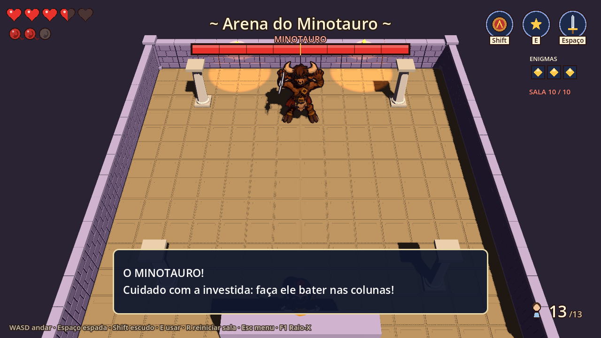
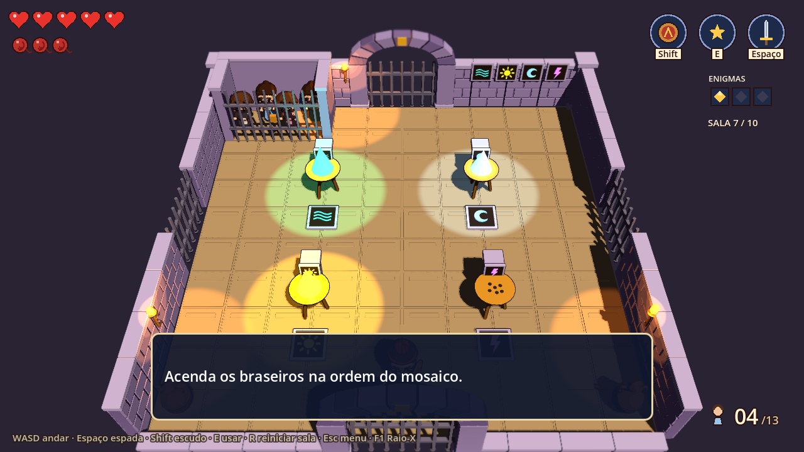
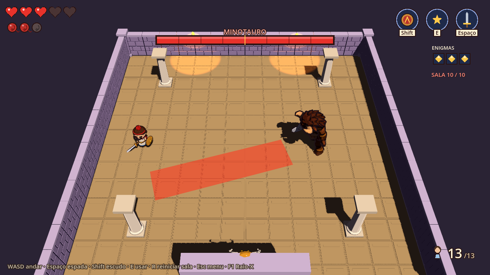

# Labirinto do Minotauro

Jogo 3D de ação e enigmas feito para a disciplina de **Computação Gráfica**
(Ciência da Computação, UNIFAL-MG), com **Blender** e **Godot 4.7**.
Visual de maquete de brinquedo, inspirado em *The Legend of Zelda: Link's Awakening* (remake).



## A história

Atenas deve pagar um tributo a Creta: 14 jovens são jogados no labirinto
construído por Dédalo, onde vive o Minotauro. **Teseu** se oferece como um
deles para acabar com isso. Na entrada, **Ariadne** lhe entrega um novelo de lã,
que é a chance de voltar se cair no labirinto.

Teseu atravessa portais para salas desconhecidas, liberta os 13 companheiros
presos resolvendo 3 enigmas e enfrenta o Minotauro.

## Como rodar

1. Instale o **Godot 4.7** (versão padrão).
2. Clone o repositório e, no Godot, clique em **Importar** e escolha o `project.godot`.
3. Espere a importação dos modelos e aperte **F5**.

O projeto usa o renderizador **Compatibilidade** (OpenGL 3), que roda em máquinas
modestas e GPUs integradas.

## Controles

| Tecla | Ação |
|---|---|
| WASD / setas | andar |
| Espaço / J | espada |
| E / K | usar (alavanca, braseiro, espelho) |
| andar contra a estátua | empurrar |
| R | reiniciar a sala atual |
| Esc / P | menu de pausa |

---

## O que já temos

### Estrutura do jogo
- **Salas ligadas por portais:** não há corredores. Ao vencer uma sala, cada
  porta vira um portal com destino **sorteado e escondido**. O sorteio garante
  que sempre exista caminho para um enigma pendente, então o jogo nunca trava.
- **3 salas de enigma + 3 salas de combate.** As de combate podem se repetir,
  com +1 inimigo a cada visita, e curam o Teseu quando vencidas.
- Ao entrar numa sala, as portas fecham com grade até os minitaurinhos serem derrotados.
- Com os 3 enigmas resolvidos, um dos portais passa a levar ao Minotauro.

### Enigmas
| Sala | Enigma |
|---|---|
| Sala das Estátuas | empurrar estátuas de touro até placas de pressão (com alavanca para reiniciar) |
| Sala dos Braseiros | acender braseiros na ordem do mosaico, cada símbolo com sua cor; errar chama reforço |
| Sala dos Espelhos | girar espelhos para levar um feixe de luz até um cristal |



### Chefe: o Minotauro
Corpo de cavalo, tronco e cabeça de touro, machado duplo. Padrões com aviso visual:
- **Golpe de machado:** ele ergue o machado e bate no chão, soltando uma onda de choque.
- **Investida:** uma faixa vermelha no chão avisa antes; se ele bater numa parede ou coluna, fica **atordoado** e leva dano em dobro.
- **Fase 2:** com metade da vida, fica mais rápido e chama 2 minitaurinhos.
- Barra de vida, tremor de câmera e tela de vitória.



### Sistemas
- **Novelo de Ariadne:** 3 voltas (respawns). Ele fica na cabeça do Teseu e encolhe a cada morte.
- **HUD estilo Link's Awakening:** corações com meio coração, novelos, botões
  de item, enigmas, contador de atenienses e caixa de diálogo com texto digitado.
- Reiniciar a sala (R), menu de pausa e reiniciar o jogo.
- Colisão robusta: empurrão por física, paredes grossas, chão infinito e resgate se cair do mapa.
- **Câmera de diorama:** travada no centro de cada sala e com zoom maior na arena.

### Arte (Blender, gerada por script Python)
Kit modular do cenário (piso, paredes, pilares, arco, grades, tochas, portão),
props (colunas gregas, ânforas, ossos), objetos dos enigmas, prisioneiros,
**espada xiphos**, **escudo hoplon** e o **Minotauro articulado**.


### Técnicas de Computação Gráfica
| Técnica | Onde |
|---|---|
| Raycast + reflexão especular `r = d − 2(d·n)n` | `scripts/puzzles/espelhos/fonte_luz.gd` |
| Shader de portal (espiral em coordenadas polares) | `scripts/visual/portal.gdshader` |
| Pós-processamento tilt-shift (efeito miniatura) | `scripts/visual/tilt_shift.gdshader` |
| Animação procedural por pivôs (sem esqueleto) | `scripts/inimigos/minotauro.gd` |
| Coração por curva paramétrica no HUD | `scripts/ui/hud_desenho.gd` |
| Malha gerada em código (rastro da espada) | `scripts/jogador/teseu_prototipo.gd` |
| MultiMesh para o piso (1 draw call por sala) | `ferramentas/godot/gerar_cenas.gd` |
| Modelagem procedural (bmesh / sólidos de revolução) | `ferramentas/blender/modelos.py` |

### Ferramentas
- `ferramentas/blender/modelos.py`: gera todos os modelos (`.glb` + `.blend`).
- `ferramentas/godot/gerar_cenas.gd`: monta todas as cenas a partir dos modelos.
- `ferramentas/godot/teste_automatico.gd`: joga o jogo sozinho e confere **84 regras**
  (salas, enigmas, sorteio dos portais, colisão, morte e luta do chefe).

```bash
godot --path . --script res://ferramentas/godot/teste_automatico.gd
```

---

## O que pode melhorar

### Prioridade alta
- [ ] **Modelo final do Teseu**, com rig e animações (andar, atacar, dano, morte).
  Hoje ele usa o corpo do NPC prisioneiro.
- [ ] **Modelo final do minitaurinho** (hoje é feito de formas primitivas no Godot).
- [ ] **Som e música:** passos, espada, rugido, portal, trilha das salas e do chefe.
- [ ] **Tela inicial**, com título, "Jogar" e créditos.
- [ ] **Tela de game over** própria, quando o novelo acaba (hoje o jogo só recomeça).

### Jogabilidade
- [ ] Mais variedade nas salas de combate (layouts, armadilhas, obstáculos).
- [ ] Novo tipo de inimigo (ex.: minitaurinho que arremessa pedras).
- [ ] Itens: coração extra, novelo extra escondido, escudo que bloqueia de verdade.
- [ ] Balanceamento: vida, dano e velocidade do Minotauro e dos minitaurinhos.
- [ ] Cena de Ariadne no começo e saída do labirinto no final.

### Visual
- [ ] Partículas: poeira na investida, faíscas na espada, fumaça nas tochas.
- [ ] Animação de entrada e saída nos portais.
- [ ] Mais variação de props e texturas por sala.
- [ ] Teste do renderizador Avançado+ em máquinas com Vulkan (sombras e luz melhores).

### Técnico
- [ ] Rodar o teste automático no **GitHub Actions** a cada push.
- [ ] Suporte a controle (gamepad).
- [ ] Exportar para Windows, Linux e Web.
- [ ] Salvar o progresso.

---

## Estrutura de pastas

```
assets/modelos/      modelos .glb (cenário, props, puzzles, personagens, armas)
assets/modelos/fontes/  arquivos .blend (ignorados pelo Godot)
cenas/objetos/       objetos prontos (com script e colisão)
cenas/salas/         as 6 salas
cenas/fase_principal.tscn
scripts/             lógica do jogo (GDScript)
ferramentas/         geradores de modelos e cenas + teste automático
docs/capturas/       imagens do jogo
```
