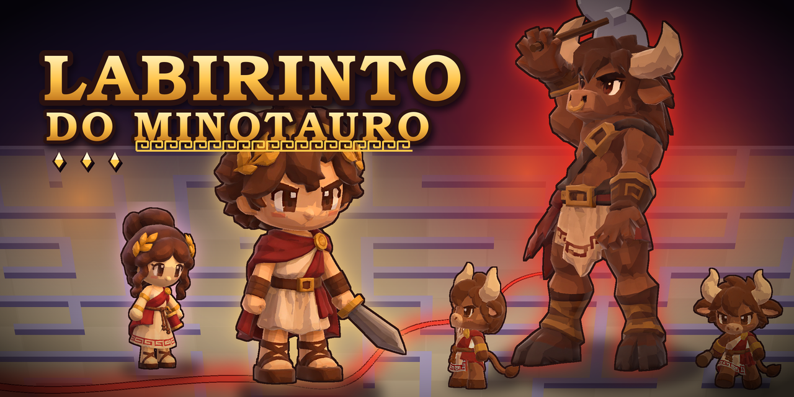

# Labirinto do Minotauro

Jogo 3D de ação e enigmas para a disciplina de **Computação Gráfica** (Ciência da
Computação, UNIFAL-MG), feito com **Blender** e **Godot 4.7**.

Teseu entra no labirinto de Creta para libertar 13 jovens atenienses e enfrentar o
Minotauro. O novelo de Ariadne o traz de volta quando ele cai, mas só 3 vezes.

## Destaques

- **Sem texto:** tudo é mostrado com ícones, balões e gestos, para não ter barreira
  de idioma. Qualquer pessoa entende, mesmo sem ler.
- **Cutscenes** com vários ângulos de câmera, cor por cena e trilha própria: a abertura,
  a queda do Minotauro e a libertação dos reféns.
- **Fio de Ariadne no chão:** ao cair, o fio puxa o Teseu de volta até a porta.
- **3 enigmas** (estátuas, braseiros e espelhos), cada um com uma demonstração rápida
  na primeira vez.
- **Salas sorteadas:** cada porta é um portal para uma sala ao acaso.
- **O labirinto de verdade:** a 10ª etapa é um labirinto sorteado a cada partida, com a
  arena do Minotauro no centro. Uma coluna de luz vermelha e o rugido guiam o jogador,
  e o fio de Ariadne mostra por onde ele já passou.
- **Labirintos até os enigmas:** na primeira ida a cada enigma, o Teseu atravessa um
  trecho curto de labirinto até um portal dourado.
- **Tutorial na entrada** e dicas de tecla que aparecem só quando servem.

## Como rodar

1. Instale o **Godot 4.7**.
2. Importe o `project.godot`, de preferência numa pasta nova e vazia.
3. Espere a importação e aperte **F5**.

Em computadores mais fracos, use **Opções → qualidade baixa**.

## Controles

| Tecla | Ação |
|---|---|
| WASD / setas | andar |
| Espaço | espada |
| Shift (segurar) | escudo |
| E | usar (braseiro, espelho, alavanca) |
| andar contra a estátua | empurrar |
| Esc | pausa (lá também dá para reiniciar a sala) |
| F1 | modo Raio-X de Computação Gráfica |

## Técnicas de Computação Gráfica

| Técnica | Onde |
|---|---|
| Cel shading próprio e contorno por casca invertida | `scripts/visual/toon*.gdshader` |
| Raycast e reflexão especular `r = d − 2(d·n)n` | `scripts/puzzles/espelhos/fonte_luz.gd` |
| Animação procedural do Teseu (squash & stretch com volume constante) | `scripts/visual/anim_teseu.gd` |
| Fio de Ariadne como malha gerada a cada quadro (triangle strip) | `scripts/visual/fio_ariadne.gd` |
| Labirinto procedural (backtracking recursivo + busca em largura) desenhado com MultiMesh | `scripts/salas/labirinto.gd`, `mini_labirinto.gd` |
| Câmera de cinema: travelling, plano holandês e vertigo `d2 = d1·tan(fov1/2)/tan(fov2/2)` | `scripts/visual/camera_diorama.gd` |
| Correção de cor, vinheta e granulação (pós-processamento) | `scripts/visual/cinema.gdshader` |
| Tilt-shift (efeito maquete) | `scripts/visual/tilt_shift.gdshader` |
| Ícones vetoriais e coração por curva paramétrica | `scripts/ui/pictograma.gd`, `hud_desenho.gd` |
| Shader de portal em coordenadas polares | `scripts/visual/portal.gdshader` |
| Partículas e hitstop (`Engine.time_scale`) | `scripts/visual/efeitos.gd` |
| Modo Raio-X: colisões, normais e vetores da reflexão | `scripts/visual/raio_x.gd` |
| Modelagem procedural, rig, pesos e animação por esqueleto | `ferramentas/blender/` |
| Simplificação de malha (1,9 mi → 12 mil triângulos) | `ferramentas/blender/blend_para_glb.py` |
| Síntese sonora (Karplus-Strong, filtros IIR) | `ferramentas/audio/gerar_sons.py` |

## Teste automático

O teste joga sozinho e confere mais de 110 regras. Com janela, também salva capturas
de tela em `user://capturas/`.

```bash
godot --headless --path . --import
godot --path . --script res://ferramentas/godot/teste_automatico.gd
```

## Estrutura

```
assets/         modelos (.glb), sons e músicas
cenas/          título, fase principal, salas e objetos
scripts/        lógica do jogo (GDScript) e shaders
ferramentas/    geradores de modelos, sons, cenas e capa; teste automático
docs/capturas/  imagens do README
```

## Grupo "Herdeiros de Luca"

Guilherme Aredes · Melissa Alves · Mel Dias · Diego Vinna · Francisco Toro · Pedro Ferreira
