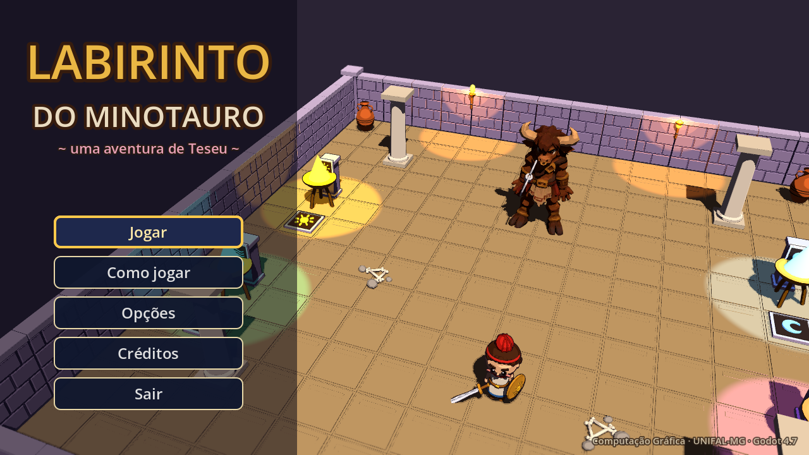
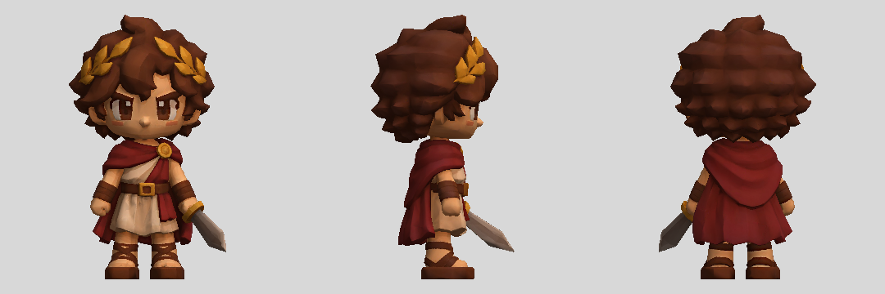
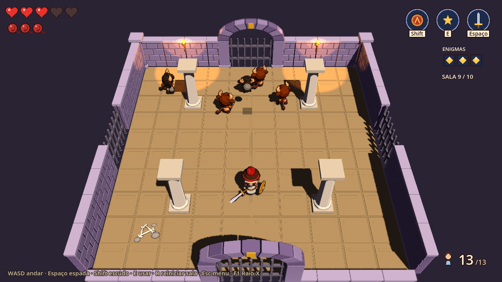
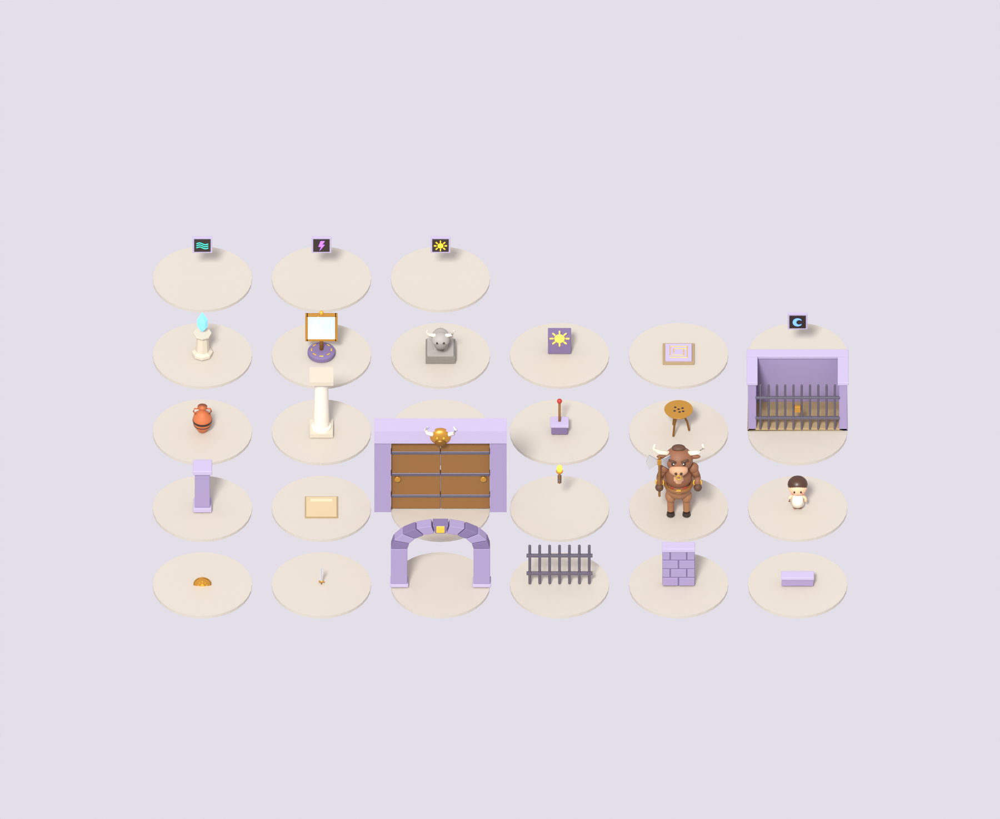
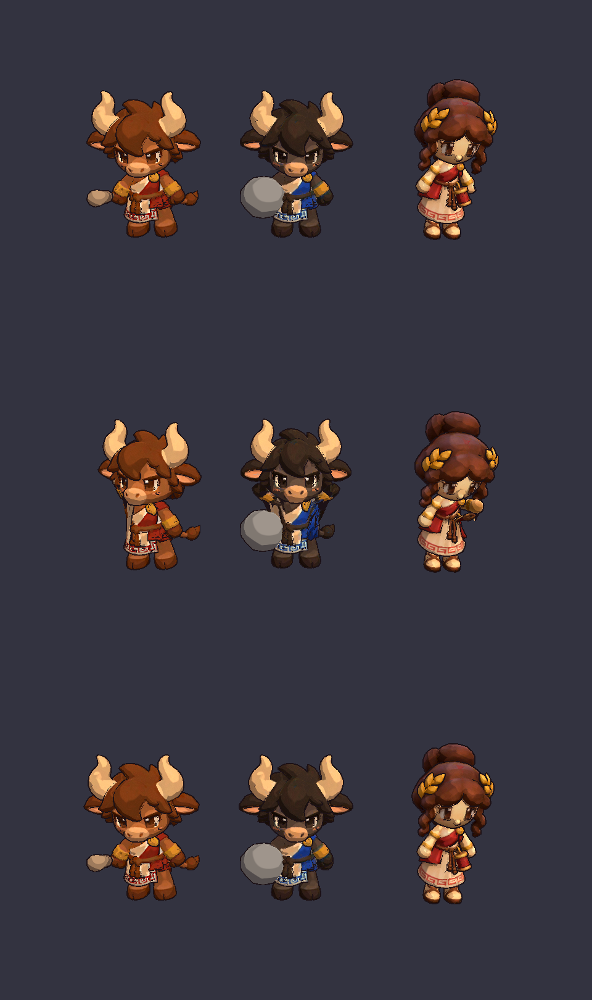

# Labirinto do Minotauro

Jogo 3D de ação e enigmas feito para a disciplina de **Computação Gráfica**
(Ciência da Computação, UNIFAL-MG), com **Blender** e **Godot 4.7**.
Visual de maquete de brinquedo, inspirado em *The Legend of Zelda: Link's Awakening* (remake).



## A história

Atenas deve pagar um tributo a Creta: 14 jovens são jogados no labirinto
construído por Dédalo, onde vive o Minotauro. **Teseu** se oferece como um
deles para acabar com isso. Na entrada, **Ariadne** lhe entrega um novelo de lã,
que é a chance de voltar se cair no labirinto.

Teseu atravessa portais para salas desconhecidas, liberta os 13 companheiros
presos resolvendo 3 enigmas e enfrenta o Minotauro.

## Como rodar

1. Instale o **Godot 4.7** (versão padrão).
2. Clone o repositório e, no Godot, clique em **Importar** e escolha o `project.godot`.
3. Espere a importação dos modelos e sons e aperte **F5** (abre a tela de título).

O projeto usa o renderizador **Compatibilidade** (OpenGL 3), que roda em máquinas
modestas e GPUs integradas. Em **Opções** dá para trocar a qualidade gráfica; em GPU
integrada (ex.: Radeon 610M, Intel UHD) o jogo já começa na qualidade **baixa**.

## Controles

| Tecla | Ação |
|---|---|
| WASD / setas | andar |
| Espaço / J | espada |
| Shift / L (segurar) | escudo: bloqueia golpes e pedras que vêm da frente |
| E / K | usar (alavanca, braseiro, espelho) |
| andar contra a estátua | empurrar |
| Esc / P | menu de pausa |
| **F1** | **Raio-X de CG** (colisões, normais, vetores da reflexão, draw calls) |
| F2 | liga/desliga o tilt-shift |
| F3 | troca cel shading (toon) ↔ iluminação PBR padrão, para comparar |

---

## Jogo sem texto (para qualquer pessoa, em qualquer idioma)

Pedido do professor: o jogo tem que ser fácil de entender até para quem nunca jogou
nada, sem depender de idioma. A referência foi **Angry Birds**: nenhuma palavra na tela.
Todo texto do jogo virou **pictograma** desenhado por código (`scripts/ui/pictograma.gd`,
mais de 50 ícones vetoriais no mesmo estilo dos corações do HUD) organizado em
**frases visuais** (`scripts/ui/frase_visual.gd`):

| Antes (texto) | Agora (sem texto) |
|---|---|
| Falas da Ariadne e do Teseu | **Abertura em 3 atos, sem palavras** (abaixo): balões de ícones (`scripts/ui/balao.gd`), balões de **pensamento animados** (`scripts/ui/pensamento.gd`), gestos e uma "voz" de bipes |
| "Acenda os braseiros na ordem do mosaico" etc. | **Mini-cena de ~3 s** que *mostra* o enigma (abaixo) |
| "Os portais levam a salas ao acaso: resolva os 3 enigmas…" | `[portal] → [◆][◆][◆] → [Minotauro]` |
| "Sala das Estátuas libertada! Faltam 2 enigmas" | `[◆][◇][◇]` (diamantes cheios e vazios) |
| "Um rugido ecoa… o Minotauro espera" | rugido + tremor de câmera + `[◆◆◆] → [Minotauro]` |
| "Cuidado com a investida: faça ele bater nas colunas!" | `[Minotauro] → [coluna] → [estrelas]` |
| "Sala vencida! Teseu recupera 2 corações" | `[✓]  [+][♥][♥]` |
| "Restam 2 voltas no novelo" | `[novelo][novelo][novelo vazio]` |
| "SALA 3 / 10" | trilha de bolinhas terminando na cabeça do Minotauro |
| Nome da sala no topo | ícone do tipo de sala (estátua, chamas, espelho, espadas, Minotauro) |
| Rodapé "WASD andar · Espaço espada…" | teclas **desenhadas** + o ícone do que fazem |
| — (novo) | tecla **[E] flutuando** sobre o objeto que dá para usar agora |
| — (novo) | **setas pulando** sobre os portais abertos ("é por aqui") |
| Menus, pausa, vitória, game over | botões com ícones (▶, ?, engrenagem, casa, reiniciar…); números continuam (são universais) |
| "Como jogar" (parágrafo) | diagrama com 7 frases visuais |

O texto antigo continua como **dica do mouse** (tooltip) nos botões, para acessibilidade.
Os créditos continuam com os nomes do grupo.

### Abertura: a história contada como cinema (~40 s, Esc pula)
Regra de ritmo: **emoção segura o plano** (2,5–4 s), **ação corta rápido** (0,5–1 s);
silêncio antes do susto; plano de reação depois de cada acontecimento.
1. **O labirinto e os reféns** (azul frio) — tela preta com choro e um rugido distante;
   plano altíssimo descendo (o labirinto é enorme); grades em primeiro plano com a câmera
   entrando entre as barras; **close num refém** chorando `[😢][Minotauro]`; as outras
   celas em cortes rápidos (de lado, de cima); a conta `[cela][ateniense] 13`.
2. **O Minotauro** (vermelho) — silêncio; só a **silhueta** contra uma luz vermelha atrás
   dele; câmera rente ao chão no **casco** pisando; **revelação** dos pés ao rosto e o
   rugido com vertigo, câmera inclinando e a música do chefe entrando junto; o machado em
   **3 planos rápidos** (sobe / impacto com flash e tempo congelado / onda vista de cima);
   os minitaurinhos surgem e **correm para a câmera** — corte seco para o preto.
3. **A esperança** (dourado) — **reação**: close no Teseu assustado; a Ariadne **entra em
   quadro**; ela imagina o plano (pensamento animado) com a câmera se aproximando;
   **contraplano** no Teseu, decidido; o **novelo voando em câmera lenta**; o pensamento do
   novelo; a regra; e o **plano de herói**: câmera baixa atrás do Teseu olhando o portal aceso.

**Queda do Minotauro:** o golpe final **congela como uma foto** em preto e branco; câmera
lenta com **3 ângulos** (baixo, lado, cima); **silêncio** num plano parado de longe; os
minitaurinhos se assustam e fogem; o Teseu ergue a espada e a música entra triunfal.
(Os tempos dessa cena usam relógio real, então a câmera lenta não estica a cena.)

Dentro do jogo, ao entrar numa sala com cela, os atenienses gritam `[!]` de novo,
ligando a cena de abertura ao objetivo da sala.

### Linguagem de cinema nas cenas
- **Correção de cor por ato** (`scripts/visual/cinema.gdshader`: tinta, saturação, contraste,
  vinheta e granulação de filme lendo a tela): azul frio nas celas (medo), vermelho no
  Minotauro (perigo), dourado com a Ariadne (esperança); quase sem cor na câmera lenta do
  golpe final.
- **Faixas pretas 2.39:1** (formato de cinema) calculadas pela proporção da tela.
- **Grua** no plano de abertura: a câmera desce do alto do labirinto até a cela.
- **Vertigo** (*dolly zoom*) no rugido: a câmera avança enquanto a lente abre
  (`d2 = d1·tan(fov1/2)/tan(fov2/2)`), o Minotauro fica do mesmo tamanho e o fundo estica;
  junto, a câmera inclina (**plano holandês**) e uma **luz vermelha** pulsa embaixo dele.
- **Impacto:** quando o machado bate no chão, flash na tela, o tempo congela e a tela treme.
- **Câmera na mão:** balanço leve em todos os planos (mais forte na correria dos minitaurinhos).
- **Trilha por ato:** tensa nas celas, a do chefe no Minotauro, a do título com a Ariadne.

### O fio de Ariadne de verdade
Uma fita vermelha (`scripts/visual/fio_ariadne.gd`) sai do novelo na cabeça do Teseu e se
desenrola no chão por onde ele anda, desde a porta em que ele chegou. Quando ele cai, em
vez de teleportar, **o fio o puxa de volta** pelo mesmo caminho (enrolando enquanto puxa)
e só então ele renasce na porta. *CG:* a malha é refeita a cada quadro (`ImmediateMesh`,
triangle strip): tangente `t = p[i+1] − p[i−1]` e lateral `l = normalize(−t.z, 0, t.x)·largura/2`.

### Tutorial jogável e teclas na hora certa
- Na entrada há **3 ânforas** para quebrar com a espada (a tecla [Espaço] aparece em cima delas).
- As **setas** aparecem em cima do Teseu até ele andar; [Espaço] aparece sobre os primeiros
  inimigos; [Shift][escudo] aparece quando vem uma pedra e ele ainda nunca bloqueou.
- Cada dica some sozinha quando o jogador já aprendeu.

### Peso nos golpes (game feel)
*Hitstop* (o tempo congela 0,06 s quando a espada acerta, `Efeitos.congelar` com
`Engine.time_scale`), flash branco no inimigo, tremor de câmera e um "soco" de zoom no golpe
que derruba.

### Recompensas em cena
- **Cela aberta:** corte rápido em close nos atenienses pulando com balões de coração
  (no começo eles choravam).
- **Queda do Minotauro:** câmera lenta e 3 ângulos — câmera baixa (a mesma de quando ele
  rugiu) enquanto ele cai com estrelinhas; plano de cima com os minitaurinhos fugindo
  assustados; câmera baixa no Teseu pulando com o troféu. No final, os atenienses
  comemoram com corações.

### Enigmas que se explicam sozinhos
Na 1ª vez que um enigma é liberado, a câmera faz uma mini-cena (Espaço/E pula),
como num tutorial do Angry Birds:
- **Estátuas:** as placas ganham um anel dourado pulsando e "fantasmas" translúcidos das
  estátuas deslizam até elas, em L (como o empurrão funciona).
- **Braseiros:** a câmera mostra o mosaico (as placas pulam na ordem, com sinos subindo de
  tom) e depois cada braseiro pisca na mesma ordem — como o jogo *Genius*.
- **Espelhos:** a câmera vai da fonte de luz até o cristal (anel azul) e mostra cada
  espelho com uma bolinha girando em volta ("gire este").

A cena só *mostra*: o enigma já está ativo e nada é mexido de verdade (os braseiros só
piscam, as estátuas fantasmas não têm colisão). Desligar: `Config.demonstrar_enigmas`.

### Teseu novo (modelo do Tripo3D) com animação procedural



- `assets/modelos/personagens/teseu_novo.glb` foi gerado do `teseu.blend` do grupo por
  `ferramentas/blender/tripo_para_glb.py` (lê o `.blend` do Blender 5 direto em Python,
  sem abrir o Blender): **1,9 milhão → 12 mil triângulos** com o meshoptimizer (mantém as
  costuras de UV, erro de 0,1%), textura 4K → 1K, normais suaves. Se o arquivo existir,
  o Teseu troca de modelo sozinho (o script mede a malha, ajusta a altura e põe os pés no chão).
- O modelo do Tripo é **uma malha só** (sem braços e pernas separados), então a animação
  (`scripts/visual/anim_teseu.gd`) mexe o **corpo inteiro** como um boneco de brinquedo:
  quica e ginga ao andar, respira parado, agacha com o escudo, golpe com antecipação e
  estocada (*squash & stretch* com volume constante: escala XZ = 1/√escala Y), recua ao
  levar dano, cai de costas ao morrer, e faz gestos de pantomima (sim, não, vitória, chamar,
  susto). Se o modelo tiver pivôs (Cabeca, BracoE…), eles também balançam.
- No modelo do Tripo a espada já vem na mão esquerda: a espada extra fica escondida
  (`esconder_espada_extra`) e o escudo vai para o braço direito.

---

## O que já temos

### Telas e história
- **Tela de título** com a arena em miniatura ao fundo e botões de ícone: Jogar ▶,
  Como jogar ?, Opções (qualidade gráfica, música e efeitos), Créditos e Sair.
- **Cena de abertura em pantomima:** Ariadne "conta" a história com balões de ícones e
  gestos, e o novelo voa até a cabeça do Teseu (faixas de cinema; Espaço avança, Esc pula).
- **Game over** próprio quando o novelo acaba (tentar de novo ou menu inicial).
- **Final:** o fio de Ariadne leva o Teseu de volta à entrada, deixando um rastro
  vermelho no chão; os 13 atenienses saem do portal, a Ariadne vem recebê-lo e os
  **créditos** sobem na tela. Depois, a vitória com o resumo da partida.


### Estrutura do jogo
- **Salas ligadas por portais:** não há corredores. Toda sala tem a entrada embaixo
  e 3 portais (esquerda, cima, direita). Ao vencer a sala, cada portal ganha um
  destino **sorteado e escondido**.
- **A partida tem 10 salas:** a 10ª é sempre a arena do Minotauro. O sorteio força
  enigmas quando faltam poucas salas, então os 3 enigmas sempre ficam prontos até
  a 9ª. O HUD mostra "SALA n / 10".
- **3 salas de enigma + 3 salas de combate.** As de combate podem se repetir,
  com +1 inimigo a cada visita, e curam o Teseu quando vencidas.
- Ao entrar numa sala, as portas fecham com grade até os minitaurinhos serem derrotados.
- Depois da 9ª sala, todos os portais levam ao Minotauro.

### Enigmas
| Sala | Enigma |
|---|---|
| Sala das Estátuas | empurrar estátuas de touro até placas de pressão (com alavanca para reiniciar) |
| Sala dos Braseiros | acender braseiros na ordem do mosaico, cada símbolo com sua cor; errar chama reforço |
| Sala dos Espelhos | girar espelhos para levar um feixe de luz até um cristal |

**Os enigmas mudam a cada partida:** a ordem do mosaico e a posição dos símbolos nos
braseiros são sorteadas, os espelhos começam em ângulos sorteados e a Sala das Estátuas
pode aparecer espelhada (esquerda/direita).


### Chefe: o Minotauro
Corpo de cavalo, tronco e cabeça de touro, machado duplo. Padrões com aviso visual:
- **Golpe de machado:** ele ergue o machado e bate no chão, soltando uma onda de choque.
- **Investida:** uma faixa vermelha no chão avisa antes. Se ela **acertar**, o Teseu é jogado para o
  lado e o Minotauro freia. Se ele **errar** e bater numa parede ou coluna, fica **atordoado** e leva dano em dobro.
- Se o Teseu morrer na arena, o Minotauro recupera só **25% da vida** (não a vida toda).
- **Fase 2:** com metade da vida, fica mais rápido e chama 2 minitaurinhos.
- Barra de vida, tremor de câmera e tela de vitória.


### Combate
- **Escudo hoplon funcional:** segurando Shift, Teseu anda devagar e bloqueia o que vem
  da frente (minitaurinho e pedra: sem dano; Minotauro: metade). Pelas costas não protege.
- **Dois tipos de inimigo:** minitaurinho de corpo a corpo (3 golpes) e o **arremessador**
  (2 golpes), que foge de perto, ergue a pedra (aviso) e arremessa. A pedra tira 1 coração;
  o escudo bloqueia tudo e a espada quebra a pedra no ar.
- **Partículas:** faíscas na espada e no escudo, poeira dos cascos e da investida do
  Minotauro, fumaça quando um minitaurinho some, estilhaços de pedra.



### Som
- Efeitos para espada, acerto, dano, passos, escudo, portal, grade, braseiro, erro,
  enigma resolvido, rugido, cascos e golpes do Minotauro, menus e diálogos.
- **Músicas por tipo de sala:** título, exploração, enigma, combate e chefe (loops,
  com fade cruzado), mais os temas de vitória e game over.
- Tudo **sintetizado por código** (`ferramentas/audio/gerar_sons.py`): osciladores,
  ruído filtrado, envelopes e corda dedilhada Karplus-Strong para a lira grega.

### Sistemas
- **Novelo de Ariadne:** 3 voltas (respawns). Ele fica na cabeça do Teseu e encolhe a cada morte.
- **HUD estilo Link's Awakening:** corações com meio coração, novelos, botões
  de item, enigmas, contador de atenienses e caixa de diálogo com texto digitado.
- Menu de pausa (Esc) com reiniciar a sala e reiniciar o jogo.
- Colisão robusta: empurrão por física, paredes grossas, chão infinito e resgate se cair do mapa.
- **Câmera de diorama:** travada no centro de cada sala e com zoom maior na arena.
- **Desempenho:** tilt-shift otimizado (9 amostras em vez de 25, e nenhuma na faixa nítida)
  e mais leve na arena; qualidade **baixa** desliga a luz dinâmica das tochas, o
  tilt-shift e o MSAA, simplifica a sombra e renderiza em 85% da resolução.

### Arte (Blender, gerada por script Python)
Kit modular do cenário (piso, paredes, pilares, arco, grades, tochas, portão),
props (colunas gregas, ânforas, ossos), objetos dos enigmas, **espada xiphos**,
**escudo hoplon** e o **Minotauro articulado**. Personagens no estilo das folhas
de modelo do grupo: **Teseu** (cabelo cacheado, faixa vermelha, túnica e capa),
**minitaurinho** (com clava) e **arremessador**, **Ariadne** (vestido lilás,
diadema e o novelo na mão) e os atenienses presos (**rapazes e moças**).
Todos têm pivôs (cabeça, braços, pernas, cauda) e são animados por código:
andam, erguem o escudo, golpeiam com a clava e pedem ajuda nas celas.



Modo Raio-X (F1) na sala dos espelhos: vetor incidente (amarelo), normal (verde),
refletido (magenta) e o ângulo em cada espelho:


### Personagens modelados pelo grupo (Minotauro, minitaurinho e Ariadne)
Os modelos enviados pelo grupo (≈1 milhão de vértices, texturas 4K) passam por
`ferramentas/blender/personagens_grupo.py`:
1. **Otimização:** decimação para ~9 mil triângulos e textura de 1024 px (só a cor).
2. **Rig:** esqueleto com Quadril, Tronco, Cabeca, BracoE/D, PernaE/D e Cauda.
   Pesos do minitaurinho por proximidade aos ossos (com regiões: cabeça, braços,
   pernas, cauda); os da Ariadne pelos pesos automáticos do Blender, corrigidos
   para o cabelo e a capa não seguirem os braços.
3. **Animações** (viram o AnimationPlayer no Godot):
   minitaurinho: `parado`, `andar`, `atacar` (clava), `erguer` e `arremessar` (pedra), `dano`;
   Ariadne: `parado`, `andar`, `arremessar` (joga o novelo para o Teseu);
   Minotauro (esqueleto completo: coxa/canela/pé, braço/antebraço/mão, machado de
   duas lâminas na mão direita): `parado`, `andar`, `correr` (investida, chifres
   para a frente), `rugir`, `mirar` (cava o chão), `erguer` e `golpe` (machado),
   `atordoado`, `frear` e `morrer`. Cada estado da IA toca a sua animação.
4. **Arremessador:** o mesmo modelo, com a textura recolorida em HSV
   (pelo escuro, roupa azul) — `minitaurinho_grupo_arremessador.glb`.

```bash
python3 ferramentas/blender/personagens_grupo.py otimizar <original.blend> minitaurinho_grupo
python3 ferramentas/blender/personagens_grupo.py montar minitaurinho_grupo
```

No jogo, `scripts/visual/anim_modelo.gd` troca entre `parado` e `andar` pela
velocidade e toca as ações (golpe, dano, arremesso).



### Técnicas de Computação Gráfica
| Técnica | Onde |
|---|---|
| **Cel shading** próprio: `N·L` quantizado em faixas, especular Blinn-Phong de corte seco e rim light `1 − N·V` | `scripts/visual/toon.gdshader` |
| **Contorno** por casca invertida (vértice inflado na normal + `cull_front`) | `scripts/visual/toon_contorno.gdshader` |
| Troca de materiais em tempo de execução (PBR → toon) | `scripts/visual/toon.gd` |
| Decimação de malha, rig, pintura de pesos e animação por esqueleto (skinning) | `ferramentas/blender/personagens_grupo.py` |
| Recoloração de textura em HSV (variação do arremessador) | `personagens_grupo.py` → `recolorir_arremessador` |
| **Modo Raio-X** (F1): linhas com `ImmediateMesh`, formas de colisão, normais dos vértices, vetores `d`, `n`, `r` | `scripts/visual/raio_x.gd` |
| Raycast + reflexão especular `r = d − 2(d·n)n` | `scripts/puzzles/espelhos/fonte_luz.gd` |
| Shader de portal (espiral em coordenadas polares) | `scripts/visual/portal.gdshader` |
| Pós-processamento tilt-shift (efeito miniatura) | `scripts/visual/tilt_shift.gdshader` |
| Sistemas de partículas (CPUParticles3D, billboards) | `scripts/visual/efeitos.gd` |
| Síntese sonora (Karplus-Strong, filtros IIR, convolução para reverb) | `ferramentas/audio/gerar_sons.py` |
| Animação procedural por pivôs (sem esqueleto) | `scripts/inimigos/minotauro.gd`, `scripts/visual/anim_boneco.gd` |
| Coração por curva paramétrica no HUD | `scripts/ui/hud_desenho.gd` |
| Malha gerada em código (rastro da espada) | `scripts/jogador/teseu_prototipo.gd` |
| MultiMesh para o piso (1 draw call por sala) | `ferramentas/godot/gerar_cenas.gd` |
| Modelagem procedural (bmesh / sólidos de revolução) | `ferramentas/blender/modelos.py` |

### Ferramentas
- `ferramentas/blender/modelos.py`: gera todos os modelos (`.glb` + `.blend`).
- `ferramentas/audio/gerar_sons.py`: gera todos os efeitos (`.wav`) e músicas (`.ogg`).
- `ferramentas/godot/gerar_cenas.gd`: monta todas as cenas a partir dos modelos.
- `ferramentas/blender/tripo_para_glb.py`: converte um `.blend` do Tripo3D em `.glb` leve
  (`pip install zstandard meshoptimizer numpy pillow`).
- `ferramentas/godot/teste_automatico.gd`: joga o jogo sozinho e confere **mais de 110
  regras** (título, salas, enigmas sorteados, portais, escudo, arremessador, colisão,
  música, morte, abertura, game over e luta do chefe).

```bash
godot --headless --path . --import     # 1ª vez: importa modelos e registra as classes novas
godot --path . --script res://ferramentas/godot/teste_automatico.gd
```

---

## O que pode melhorar

### Prioridade alta
- [x] **Modelo final do Teseu** (Tripo3D) com animação procedural do corpo inteiro.
- [x] **Jogo sem texto**: pictogramas, pantomima e enigmas que se demonstram.
- [x] **Modelo final do minitaurinho** e do arremessador (modelo do grupo, com rig e animações).
- [x] **Ariadne** com o modelo do grupo, rig e animações.
- [x] Som e música · [x] Tela inicial · [x] Game over · [x] Cena da Ariadne

### Jogabilidade
- [ ] Mais variedade nas salas de combate (layouts, armadilhas, obstáculos).
- [x] Novo tipo de inimigo (arremessador) · [x] Escudo que bloqueia · [x] Enigmas sorteados
- [ ] Itens: coração extra, novelo extra escondido.
- [ ] Balanceamento: vida, dano e velocidade do Minotauro e dos minitaurinhos.
- [x] Cena final: saída do labirinto com os atenienses seguindo o fio, e créditos.
- [ ] Mais enigmas (novos tipos de sala, não só variações).

### Visual
- [x] Partículas (faíscas, poeira, fumaça, estilhaços)
- [x] Cel shading + contorno (estilo Link's Awakening) · [x] Modo Raio-X de CG (F1)
- [ ] Texturas pintadas com mapeamento UV (piso, paredes e Teseu).
- [ ] Animação de entrada e saída nos portais.
- [ ] Trocar os sons sintetizados por gravações/composições do grupo (é só substituir os
  arquivos em `assets/audio/` mantendo os nomes).
- [ ] Mais variação de props e texturas por sala.
- [ ] Teste do renderizador Avançado+ em máquinas com Vulkan (sombras e luz melhores).

### Técnico
- [ ] Rodar o teste automático no **GitHub Actions** a cada push.
- [ ] Suporte a controle (gamepad).
- [ ] Opções de volume e qualidade também no menu de pausa.
- [ ] Exportar para Windows, Linux e Web.
- [ ] Salvar o progresso.

---

## Estrutura de pastas

```
assets/modelos/      modelos .glb (cenário, props, puzzles, personagens, armas)
assets/modelos/fontes/  arquivos .blend (ignorados pelo Godot)
assets/audio/        efeitos (.wav) e músicas (.ogg)
cenas/objetos/       objetos prontos (com script e colisão)
cenas/salas/         as 6 salas
cenas/titulo.tscn    tela de título (cena principal)
cenas/fase_principal.tscn
scripts/             lógica do jogo (GDScript)
ferramentas/         geradores de modelos e cenas + teste automático
docs/capturas/       imagens do jogo
```
